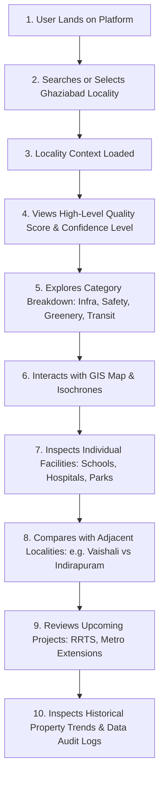

# NeighbourhoodIQ: Homebuyer User Journey & Experience Architecture

## 1. Executive Summary
This document maps how prospective homebuyers interact with the NeighbourhoodIQ platform to evaluate residential localities in Ghaziabad. It prioritizes rapid comprehension, progressive disclosure of complex geospatial and environmental data, and radical transparency regarding data confidence.

---

## 2. End-to-End User Flow

---

## 3. Detailed Step-by-Step Flow

| Step | User Action | System Output & UI Reaction | Primary User Intent |
|---|---|---|---|
| **1. Open Platform** | Enters website URL. | Displays search hero, quick-select pills for top Ghaziabad localities, and explanation of score methodology. | "Where can I begin looking?" |
| **2. Search Locality** | Types "Indirapuram" or selects a locality pill. | Autocomplete highlights matching localities and sub-sectors with current quality badges. | "Quickly select my area of interest." |
| **3. Select Locality** | Clicks on desired locality. | Smooth scroll/route transition to the Locality Overview Dashboard. | "Get immediate insights." |
| **4. View Score** | Reviews the overall Quality Score (0–100). | Circular score gauge with confidence badge (e.g. *82/100 • High Confidence*). | "Is this neighborhood generally good?" |
| **5. Category Drilldown** | Clicks on a category card (e.g., Environment). | Expands metrics: AQI history, park canopy percentage, groundwater data. | "Why is the score high or low?" |
| **6. Explore Map** | Zooms and pans the geospatial map. | Displays verified polygon boundaries, facility markers, and transit routes. | "Where is the locality relative to Delhi/Noida?" |
| **7. Check Facilities** | Filters markers by "Schools" or "Metro". | Displays 15-minute walking/driving isochrone rings and facility cards. | "Are there good hospitals and schools nearby?" |
| **8. Compare** | Clicks "Compare" and picks Vaishali. | Side-by-side comparison matrix with differential metrics. | "Should I buy in Vaishali or Indirapuram?" |
| **9. Future Infra** | Toggles "Upcoming Infrastructure". | Displays Namo Bharat (RRTS) corridors, proposed metro extensions. | "Will property value and living quality improve?" |
| **10. Historical Trends** | Toggles 3-year historical slider. | Charts showing trendlines for price per sq.ft., AQI shifts, and road development. | "Is this an appreciating and healthy market?" |

---

## 4. Key Architectural & UX Questions Answered

### Q1: What information should appear first?
**Answer:**
1. **Locality Name & Municipal Tagging** (e.g., *Indirapuram, GDA Ward 14*).
2. **Current Overall Quality Score (0–100)** alongside its **Confidence Grade** (High/Medium/Low).
3. **Executive Summary Highlights**: 3 key strengths (e.g., "Top-tier metro accessibility") and 1 primary drawback (e.g., "Peak winter AQI concerns").
*Rationale:* Homebuyers make rapid initial judgments. Presenting the aggregated score immediately builds trust, before exposing granular sub-indices.

### Q2: What should happen when a user clicks a locality?
**Answer:**
1. Update URL to `/locality/[slug]` (for clean deep-linking and bookmarking).
2. Recenter and bound the GIS map viewport to the locality's exact planning boundary.
3. Refresh all category scores, metrics, and facility lists dynamically.
4. Update the Data Coverage indicator to reflect source freshness for that specific zone.

### Q3: How will the score be explained?
**Answer:**
We use a **Weighted Composite Formula**:
$$\text{Score} = \sum (\text{Category Score} \times \text{Weight})$$
- Each score card has a `"How was this calculated?"` interactive drawer.
- The drawer explicitly outlines the formula, weighting parameters (e.g., Infrastructure 30%, Safety 25%), and underlying data points (e.g., distance to nearest multi-specialty hospital, verified school density).

### Q4: How will missing data be communicated?
**Answer:**
- Missing data is never hidden, zeroed out, or hallucinated.
- An empty field displays: `"Data Pending Field Audit"` with an informational tooltip.
- Missing data directly penalizes the **Data Coverage %** and lowers the **Confidence Grade**, signaling that the score has higher uncertainty.

### Q5: How will the map and score relate to each other?
**Answer:**
- **Bidirectional synchronization**:
  - Hovering over a score component (e.g., *Healthcare: 85*) highlights all primary and tertiary hospitals on the map with glowing markers.
  - Clicking on a map POI (e.g., *Vaishali Metro Station*) highlights the *Connectivity* category score and displays travel isochrone buffers (5, 10, 15 min walks).

### Q6: How will a user distinguish verified facts from estimates?
**Answer:**
A consistent two-tier visual badge system:
- 🔵 **Verified Record**: Official government data (e.g., UDISE+ school code, ABDM-registered hospital, DMRC schedule).
- 🟡 **Model Estimate**: Computed values or crowd-contributed data (e.g., estimated walk time, interpolated AQI boundary, OpenStreetMap unverified node).